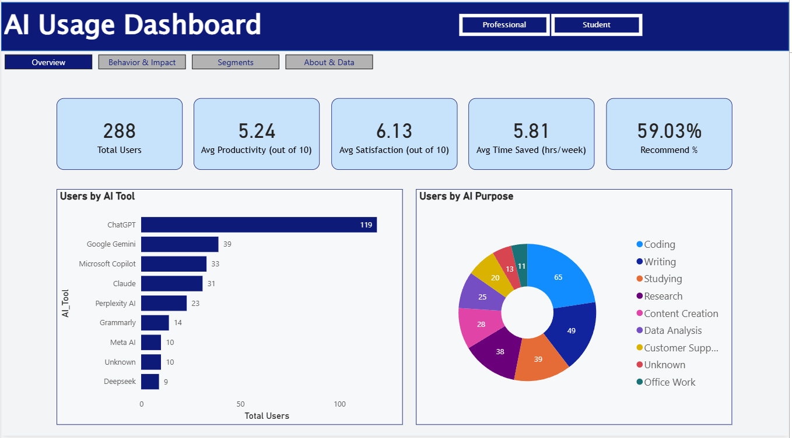
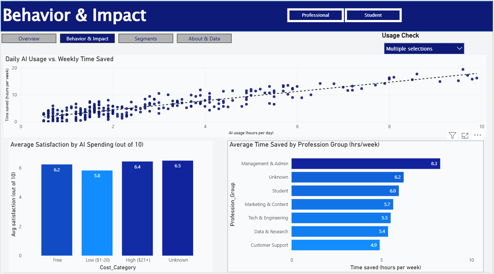
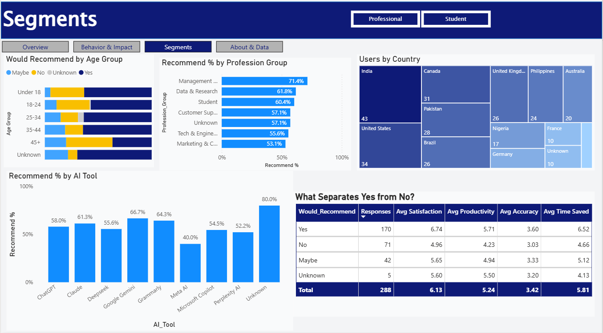
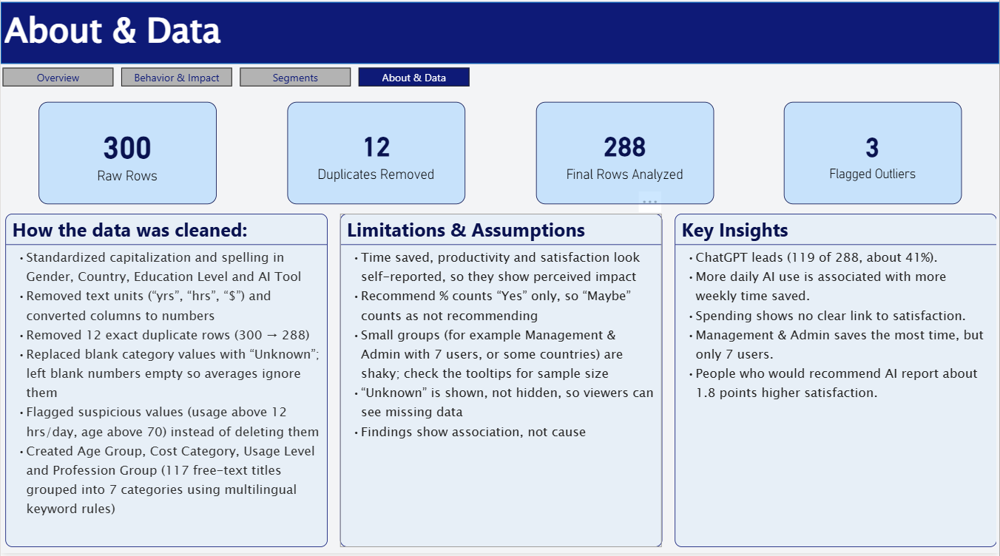

# AI Usage Dashboard (Power BI)

An interactive, four-page Power BI dashboard that explores how 288 people use AI tools, what they use them for, and what difference it makes to their productivity, time saved and satisfaction.

> **Author:** Mohammed Nakibul Alam
>
> **Tools:** Power BI Desktop, Power Query (M), DAX
>
> > **Demo video:** [Watch the dashboard walkthrough](https://drive.google.com/file/d/1RTDE4o7AJSIo2SS6XZoXe6X9w-JUo_Mk/view)

---

## Screenshots

| Overview | Behavior & Impact |
|---|---|
|  |  |

| Segments | About & Data |
|---|---|
|  |  |

---

## Business Questions

1. Which AI tools are most popular, and what do people use them for?
2. Does using AI more hours per day lead to more time saved?
3. Do people who pay for AI tools report higher satisfaction than free users?
4. Which professions save the most time?
5. What separates people who would recommend AI from those who wouldn't?

---

## Dataset

- **Size:** 300 raw rows and 19 columns (288 rows after cleaning)
- **Content:** user demographics (age, gender, country, education, profession, income), AI tool and purpose, daily usage hours, monthly AI cost, and self-reported scores (productivity, accuracy, satisfaction, time saved, would recommend)
- **Source:** [AI Usage and Impact on Students and Professionals (Kaggle)](https://www.kaggle.com/datasets/eishatuzzuhra/ai-usage-and-impact-on-students-and-professionals)
- **Note:** the data appears to be survey-based or synthetic and contained many deliberate quality issues, which made it a good cleaning exercise.

---

## Data Cleaning (Power Query)

| Problem found | What I did |
|---|---|
| Mixed units in numeric columns ("16 yrs", "2 hrs", "$0") | Removed the text first, then converted columns to numbers |
| Inconsistent spelling and capitalization (Gender, Country, Education Level, AI Tool) | Trim, Clean, Capitalize Each Word, then Replace Values with "Match entire cell contents" |
| 12 exact duplicate rows | Verified they were identical, then removed them (300 to 288) |
| Blank category values | Labeled "Unknown" so missing data stays visible |
| Blank numeric values | Left empty so averages ignore them instead of treating them as 0 |
| Suspicious values (usage above 12 hrs/day, age above 70) | **Flagged, not deleted**, with `Usage_Outlier_Flag` and `Age_Outlier_Flag` columns. Result: 3 flagged rows |
| 117 free-text profession titles in several languages | Grouped into 7 categories with a keyword-matching rule, including Portuguese, Spanish, French and German keywords |

**Helper columns created:** `Age_Group`, `Cost_Category` (plus `Cost_Sort` for ordering), `Usage_Level`, `Profession_Group`.

---

## Data Model and DAX

A single flat table (`AI_Usage`) plus a `_Measures` table holding all calculations. Key measures:

- `Total Users` (distinct count of User_ID)
- `Avg Productivity`, `Avg Satisfaction`, `Avg Accuracy`, `Avg Time Saved`
- `Recommend %` (share of users answering "Yes")
- `Responses` (row count, used for sample sizes in tooltips)

---

## Dashboard Pages

1. **Overview:** KPI cards, users by AI tool and by AI purpose, User Type slicer
2. **Behavior & Impact:** daily usage vs. weekly time saved (scatter with trend line), satisfaction by spending level, time saved by profession group, outlier slicer
3. **Segments:** recommendation by age group and profession, users by country, recommend % by tool, and a Yes / No / Maybe comparison table
4. **About & Data:** cleaning summary, limitations and key insights

**Interactivity:** cross-filtering between visuals, slicers on each page, page-navigator buttons, a custom tooltip page showing the Yes / No / Maybe breakdown per tool, and an outlier toggle.

---

## Key Insights

1. **ChatGPT dominates:** 119 of 288 users (about 41%) use it, far ahead of Google Gemini (39) and Microsoft Copilot (33).
2. **More daily use is associated with more time saved:** the scatter plot shows a clear upward trend between daily AI hours and weekly hours saved.
3. **Spending shows no clear link to satisfaction:** Free users averaged 6.2, Low spenders 5.8 and High spenders 6.4 out of 10.
4. **Management & Admin reports the highest time saved (8.3 hrs/week)**, but this group has only 7 users, so it should be treated cautiously.
5. **Recommenders report better outcomes:** 59% of users would recommend AI. Those who said Yes average 6.74 satisfaction versus 4.96 for No, and save about 6.5 hours per week versus about 4.7.

---

## Limitations and Assumptions

- Productivity, satisfaction and time saved look **self-reported**, so they show perceived impact, not measured impact.
- `Recommend %` counts "Yes" only, so "Maybe" answers count as not recommending.
- Several groups are small (for example Management & Admin with 7 users, some countries, and the "Unknown" categories). Sample sizes are shown in tooltips.
- "Unknown" values are displayed rather than hidden, so viewers can see how much data is missing.
- Findings describe **association, not causation**.

---

## How to open

1. Download `AI_Usage_Dashboard.pbix` from this repository.
2. Open it in **Power BI Desktop** (Windows).
3. If prompted, point the data source to the file in the `Raw Data` folder.

---

## Repository structure

```
AI-Usage-Dashboard/
|-- Raw Data/        original dataset (unedited)
|-- Power Bi/        AI_Usage_Dashboard.pbix
|-- Screenshots/     dashboard images
`-- README.md
```

---

## What I learned

- Cleaning messy, mixed-format data in Power Query and documenting each decision
- Flagging outliers instead of silently deleting them
- Feature engineering with conditional columns and multilingual keyword rules
- Writing DAX measures and building a measures table
- Designing a multi-page report with synced slicers, navigation, and custom tooltips
- Reporting results honestly, with sample sizes and "association, not cause" wording
